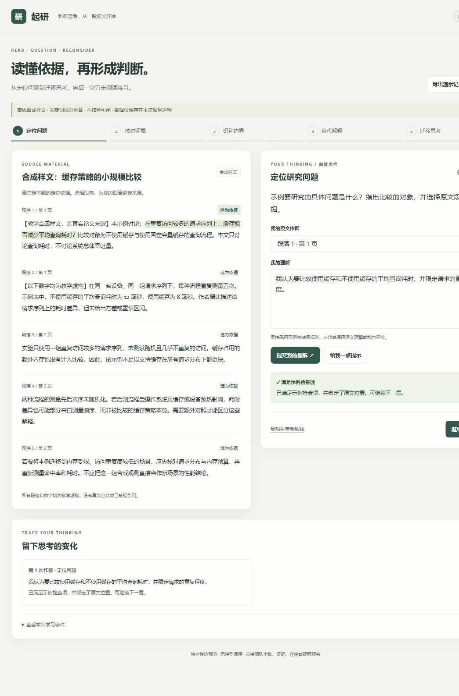

# -C

启研 agent C 模块独立开发。

当前交付：成员 C 的离线教学与阅读 MVP，源码位于 [`member-c-mvp/`](member-c-mvp/)。需要 Python 3.11+，不依赖 API key、数据库或第三方 Python 包。

## 运行

在仓库根目录执行：

```powershell
cd member-c-mvp
python -m qiyan_c.demo
```

浏览器打开 http://127.0.0.1:8765。Windows 也可双击 `member-c-mvp/start-demo.cmd`。

## 验证

```powershell
cd member-c-mvp
python tools/check.py
```

本次交付 43 项自动测试通过，覆盖 120 组基础决策、10000 组随机上限检查及本地阅读交互。

## 文档

- [模块说明与能力边界](member-c-mvp/README.md)
- [接口交接草案](member-c-mvp/docs/接口交接.md)
- [验收报告](member-c-mvp/docs/验收报告.md)
- [演示与数据结构说明](member-c-mvp/docs/演示与算法说明.md)

阅读内容为合成样文，判答使用固定关键词规则；尚未接入真实论文解析、模型语义判断、引用核验、持久化成长记录或定时提醒。接口与教学规则为待团队确认的草案。


